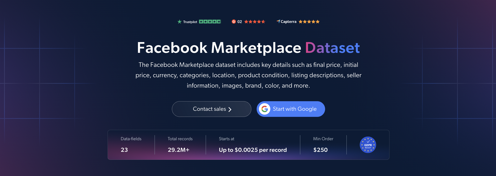

# Facebook-Marketplace-dataset-samples

<h2>A sample dataset of 1000 Facebook Marketplace listings</h2>

<a href="https://brightdata.com/products/datasets/facebook/marketplace">
   
</a>

A Facebook Marketplace dataset sample of 1000 product listings. Dataset was extracted using the <b>Bright Data API</b>.

<h2>Some of the data points that are included in the dataset:</h2>

* ```url```: URL of the Facebook Marketplace listing
* ```product_id```: Unique identifier for each listing
* ```title```: Title of the listing
* ```initial_price```: Original listed price of the item
* ```final_price```: Current or discounted price of the item
* ```currency```: Currency of the price
* ```condition```: Condition of the item as reported by the seller
* ```is_sold```: Whether the item has been sold
* ```brand```: Brand or manufacturer of the item
* ```color```: Color of the item
* ```description```: Full description of the listing
* ```root_category```: Top-level category of the listing
* ```breadcrumbs```: Category path of the listing
* ```location```: General location of the listing
* ```country_code```: Two-letter country code of the listing
* ```listing_date```: Date and time the listing was posted
* ```images```: URLs of the listing's photos
* ```videos```: URLs of the listing's videos
* ```car_miles```: Mileage of the vehicle, for vehicle listings
* ```transmission```: Transmission type, for vehicle listings
* ```vehicle_details```: Detailed vehicle attributes, for vehicle listings

And a lot more.

This is a sample subset which is derived from the "Facebook Marketplace (public data)"
dataset which includes more than <b>29,200,000 listings</b>.

Available dataset file formats: <b>JSON, NDJSON, JSON Lines, CSV, or Parquet. Optionally, files can be compressed to .gz</b>.

Dataset delivery type options: <b>Email, API download, Webhook, Amazon S3, Google Cloud storage, Google Cloud PubSub, Microsoft Azure, Snowflake, SFTP</b>.

Update frequency: <b>Once, Daily, Weekly, Monthly, Quarterly, Biannual, or Custom basis</b>.

Data enrichment available as an addition to the data points extracted: <b>Based on request.</b>

<b>[Get the full Facebook Marketplace dataset](https://brightdata.com/products/datasets/facebook/marketplace)</b>.

<a href="https://brightdata.com/products/datasets/facebook/marketplace">
</a>

<h2>What are the Facebook Marketplace datasets use cases?</h2>

<h3>1. Pricing optimization and condition insights</h3>
Businesses use Facebook Marketplace datasets to analyze initial and final prices across categories and locations. Comparing prices by item condition and sold status shows how condition affects price points in the second-hand market, helping sellers set competitive prices for both new and used products.

<h3>2. Regional market analysis</h3>
Analysts study listings by location, category and condition to understand regional market trends and consumer demand. This helps identify popular product categories, track inventory patterns and spot opportunities in different geographic areas.

<h3>3. Used vehicle market tracking</h3>
Dealers and automotive researchers track used car listings with mileage, transmission and vehicle details alongside asking prices. This helps value vehicles accurately and spot regional price differences across markets.

<h2>Free access to web scraping tools and datasets for academic researchers and NGOs</h2>

The Bright Initiative offers access to Bright Data's <b>[Web Scraper APIs](https://brightdata.com/products/web-scraper)</b> and <b>[ready-to-use datasets](https://brightdata.com/products/datasets)</b> to leading academic faculties and researchers, NGOs and NPOs promoting various environmental and social causes. You can submit an application <b>[here](https://brightinitiative.com)</b>.
